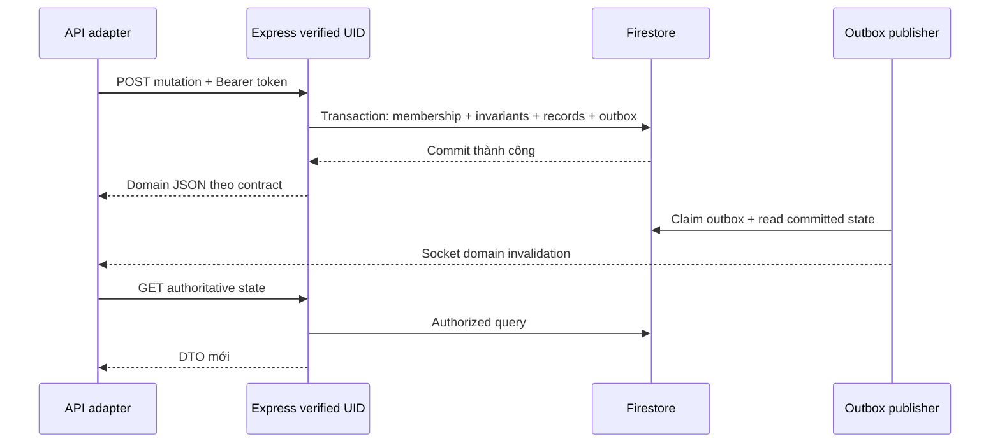

# Kế hoạch tích hợp ba workstream

## 1. Quyền sở hữu không trùng nhau

| Workstream | Owner | Sở hữu | Không tự làm thay |
|---|---|---|---|
| A — Frontend | Frontend Developer / chủ dự án | apps/mobile UI/navigation/maps/state, Mock/API adapters, Firebase Auth client provider, token persistence/refresh, frontend tests | Không dùng Admin SDK, tự tính vote authoritative hoặc sửa Rules để bypass API |
| B — Backend | Backend Developer | Express routes/middleware/services/serializers, Firebase Admin bootstrap/repositories/query/transactions, AI/weather/worker/Socket/outbox | Không tự đổi schema/index/DTO đã chốt hoặc làm thêm frontend màn hình trùng |
| C — Database | Database Developer | Firebase projects/Auth provider config/IAM, Firestore model/Rules/indexes, emulator fixture/seed, migration/export/verification/rollback | Không viết một bộ vote/AI business logic thứ hai trong client/Rules hoặc database triggers |
| Shared review | Ba người, owner quyết định release | Contract, root lock/CI, seed semantics, token/realtime policy và cutover | Một thay đổi API/collection phải có consumer + owner review cùng PR |

Backend triển khai các repository/query; Database cung cấp model/index và tests xác minh. Database Rules không thay Backend authorization vì Admin bypass Rules. Frontend giữ type source hiện tại; chưa tạo package shared mới hoặc frontend Firebase provider trong Phase 4.

## 2. Milestones có thể nghiệm thu

| Mốc | Owner | Phụ thuộc | Output cụ thể | Integration test | Definition of Done |
|---|---|---|---|---|---|
| M1 Environment/repo | Chủ dự án + từng người | Remote Git thật và máy cài đúng vai trò | Remote được cấp, branch/CI, private env, version tool pin | Clone sạch, npm ci theo workspace, docs validator | Không secret/dependency cache trong commit; FE mock và server legacy chạy |
| M2 Firebase foundation | Database; Backend review | M1 | Project dev/prod, Auth Email/Password, Firestore, Rules/index/seed emulator, IAM | Client Rules denies, Admin connectivity, idempotent seed | CLI/project/ports/Java khớp, tests có evidence, không deploy rules mở |
| M3 Auth | Backend + Frontend mỗi bên đúng layer | M2, C01–C03/C23 | Verify Firebase ID token, profile ensure/upsert, compatibility endpoints; client Auth SDK/refresh | Register/login/me/profile/reset/change/revoke/expiry, socket reconnect token mới | Không custom token giả ID; API DTO giữ; chưa release nếu chỉ lưu ID token mà không refresh |
| M4 Catalogue | Backend + Database | M2–M3 | Cities/places giữ IDs/provenance/retired visibility; serializer/cache/search/page-internal | Đà Lạt80, Vũng Tàu40, retired detail, search bỏ dấu, full array | Không lost FK, không tọa độ giả, no first-page truncation |
| M5 Groups | Backend; Database indexes | M3–M4 | Create/join/membership/preferences/group view, invite registry | Concurrent join, caller role, outsider, overwrite revision audit, mode clear pointer | Một leader, membership count đúng, C17/C21 được giữ hoặc thay qua PR được duyệt |
| M6 Realtime/collaboration | Backend; Frontend lifecycle | M5 | Wishlist/comments/notifications/activity/outbox, Socket rooms và typing | Hai API clients, author denial, reconnect/refetch, duplicate event retry | Firestore là dữ liệu thật, không listener UI thứ hai, no duplicate notification |
| M7 AI | Backend; Frontend dùng DTO cũ | M4–M6, facts weather M8 | Smart Discovery/planner, validators, metadata, RULE_BASED trước LLM | Mocked Responses schema/refusal/timeout, foreign ID/fact reject, constraints conflict | Không paid model call trong CI, engine/demo đúng, AI không tự apply |
| M8 Weather | Backend; Database snapshots/indexes | M4–M6 | Providers/cache/quota/checks/rain/verification/radar/lease | Missing sources, stale/cache, demo isolation, alert dedupe, forecast invalidation | Không missing=0, radar chỉ quan sát, no fake accuracy, no auto plan switch |
| M9 Voting | Backend; Database transaction tests | M5–M8 | Electorate docs, delta vote, atomic apply/currentPlan/stale, deadline worker | Two concurrent votes/winners, late voter, expired/constraints/mode | Chính xác một apply, counters đúng, no client direct writes, 30 phút backend |
| M10 E2E/cutover | Chủ dự án phối hợp cả ba | M1–M9 + rehearsal | API Mode journey, device report nếu có, migration manifest, rollback runbook, release tag | Login→map→wishlist→AI→route→proposal→vote→notifications; reconnect/weather change | API/Firebase dev test thực pass, source/code/contracts đồng bộ, owner chấp thuận cutover |

M7/M8 phát triển song song sau M6; weather facts giả lập có nhãn dùng trong test AI trước khi live provider sẵn sàng. Thứ tự đọc milestone không phải lời hứa ngày hoàn thành. Không cần chờ Android Studio để Backend/Database bắt đầu M1/M2.

## 3. Cách tích hợp thay đổi

1. Database PR đầu xác định paths/fields/indexes/Rules + fixtures. Chạy Rules tests bằng client SDK và repository tests bằng Admin riêng.
2. Backend PR từng domain port SQL query thành repository, giữ pure planner/validator. DTO serialization là cửa duy nhất từ Firestore sang API; snapshot SDK không truyền thẳng ra client.
3. Frontend PR Auth provider lấy Firebase SDK token trong adapter, giữ MockDataAdapter và screens. Chỉ switch API env sau khi M3 thực sự đạt; không xóa mock để che lỗi integration.
4. Integration branch dùng source Firestore duy nhất; legacy SQL vẫn branch/tag để so sánh và rollback, không dual-write cùng môi trường production.
5. Mọi sửa endpoint/body/error/event/enum phải cập nhật [API_CONTRACT](API_CONTRACT.md), [clarifications](CONTRACT_CLARIFICATIONS.md), source type/Zod liên quan và tests trong cùng PR. Các câu hỏi chưa chốt ghi issue có owner/test; không bịa method adapter hoặc route mới để né thiếu implementation.

## 4. Luồng kiểm chứng từng loại dữ liệu

Typing không qua DB/outbox. Firebase Auth token refresh do Auth SDK/provider; không gửi refresh token vào notification/comment payload. Rules trực tiếp không mở write cho vote kể cả leader.

## 5. Gate trước release và rollback

Mốc 10 chưa đạt chỉ vì frontend mock pass, APK build được, hay backend SQL smoke pass. Cần separate evidence API + Firebase + hai client + Rules/IAM + migration checks. Chạy cutover rehearsal bằng backup/read-only source; sau khi có write mới vào Firebase thì rollback phải reconcile delta, không đơn giản trỏ lại SQL cũ. Xem [Database plan](DATABASE_DEVELOPMENT_PLAN.md), [checklist](INTEGRATION_CHECKLIST.md).

Quyết định triển khai production, billing/service credentials và publish Git thuộc chủ dự án/owner được cấp quyền. Phase 4 không tạo cloud project, không deploy, không thay database thật.
