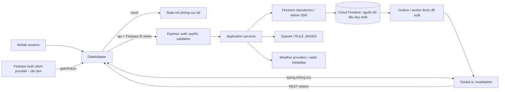

# Kiến trúc hiện tại và đích Firebase

## 1. Hiện trạng được đọc từ source

| Vùng | Mã nguồn | Có gì và giới hạn |
|---|---|---|
| Workspace | [package.json](../../package.json) | npm workspaces `apps/*`, Node `>=22`; `npm test` ở root chỉ chạy server |
| Mobile | [App.tsx](../../apps/mobile/App.tsx), [types.ts](../../apps/mobile/src/types.ts) | React Native/Expo/TS; context và router tự quản lý, không dùng React Navigation; 40 route, lịch một ngày |
| Data facade | [api.ts](../../apps/mobile/src/api.ts), [adapter](../../apps/mobile/src/api/contracts/adapter.ts) | `request<T>`, `subscribeData`, storage; `EXPO_PUBLIC_DATA_SOURCE` chọn mock/api; không fallback API lỗi sang mock |
| Mock | [MockDataAdapter](../../apps/mobile/src/api/adapters/MockDataAdapter.ts) | State trong một JavaScript runtime, event nội bộ, không đồng bộ tab/thiết bị, reload mất mutation |
| API client | [ApiDataAdapter](../../apps/mobile/src/api/adapters/ApiDataAdapter.ts) | REST Bearer + Socket.io; cache forecast/catalogue, reconnect refetch, cleanup room/typing |
| Express | [app.ts](../../apps/server/src/app.ts), [index.ts](../../apps/server/src/index.ts) | 38 route, Zod, CORS, Helmet, rate limit; JWT HS256 7 ngày; password recovery/change chưa có |
| Persist | [db.ts](../../apps/server/src/db.ts), [SQL](../../apps/server/migrations/001_initial.sql) | PostgreSQL hoặc PGlite; một migration được chạy lúc startup, không có chuỗi migration Firebase |
| Domain | [services.ts](../../apps/server/src/services.ts), [store.ts](../../apps/server/src/store.ts) | Membership, chốt cử tri, vote trong transaction, stale/expired, alert, lịch sử, notification |
| AI | [recommendations.ts](../../apps/server/src/recommendations.ts), [planner.ts](../../apps/server/src/planner.ts), [llm.ts](../../apps/server/src/llm.ts) | Smart Discovery, planner, Responses Structured Outputs qua `fetch`; kiểm facts/IDs; fallback `RULE_BASED`; không cài OpenAI npm SDK |
| Weather | [weather.ts](../../apps/server/src/weather.ts) | Open-Meteo, WeatherAPI, Tomorrow.io; normalization, cache, snapshot, internal quota budget; worker LIVE + verification |
| Maps | [map](../../apps/mobile/src/map/MapExplorer.tsx), [radar](../../apps/mobile/src/RadarMap.web.tsx) | Native Maps có cấu hình/fallback; web Leaflet/cluster đã vendor; OSM và radar tiles vẫn cần mạng |

Giữ lại pure functions, schema AI, DTO camelCase, 80 ID Đà Lạt có nguồn OSM, catalogue Vũng Tàu cũ, event names và toàn bộ frontend mock. Chỉ thay tầng persistence/auth khi migration. SQL/PGlite, custom JWT và auto-seed SQL trở thành **legacy sau cutover**, chưa phải mã thừa để xóa ngay.

## 2. Quyết định đích của nhóm

**Chọn REST + Socket.io để tương thích adapter đang có.** Persistent records nằm ở Firestore; Socket không giữ bản sao authoritative của plan/vote/wishlist. Một thao tác: request → kiểm quyền → transaction Firestore → commit → event → client đọc lại REST. Không dual-write SQL/Firestore trong production. Không thêm `onSnapshot` vào từng màn hình. Nếu sau này đổi transport sang listeners, thay `subscribe` trong adapter và tắt invalidation trùng cho cùng record theo một PR/ADR riêng.

MVP triển khai một Express/Socket process và một worker có lease Firestore. Nhiều replica cần transport chia sẻ phòng Socket và worker lease/outbox; không dùng cờ `busy` trong RAM như khóa phân tán. Firebase Functions/Redis không phải dependency đang có và không bắt buộc cho MVP.

## 3. Danh tính và compatibility

Hiện tại mobile gọi `/auth/login`/`register`, nhận `{token,user}`, lưu token vào SecureStore/native hoặc localStorage/web; HTTP 401 dẫn về login. Chưa có Firebase Auth persistence/refresh.

Đích chính: Frontend bổ sung Firebase Auth client provider **bên trong auth/data layer**: đăng nhập/đăng ký qua SDK, lấy ID token, gọi `/auth/me` lấy User DTO, trả đúng `AuthResult` cho flow cũ. Không thực hiện cả SDK login và REST login trong cùng một lần đăng nhập. `onIdTokenChanged` cập nhật token mà không gọi flow `authenticate()` hiện tại khiến quay về Home/xóa state sau mỗi refresh. Socket reconnect bằng token mới, sign-out hủy subscription. Cần chọn và kiểm thử persistence tương thích Expo/RN; AsyncStorage hiện chưa là dependency trực tiếp.

Backend vẫn giữ POST `/auth/login` và `/auth/register` làm **compatibility entrypoint** cho client hiện tại: gọi Firebase Auth REST `accounts:signInWithPassword`/`accounts:signUp`, verify ID token rồi trả `{token:idToken,user}`. Không lưu/log password hoặc phát JWT HS256 mới. Đây vẫn là một nguồn danh tính Firebase, không phải cơ chế password SQL thứ hai. Contract cũ không có refresh token: client cũ phải login lại khi ID token hết hạn; không tự thêm `refreshToken` vào DTO. Release tích hợp phải có Auth provider phía frontend trước khi tuyên bố hỗ trợ phiên tự làm mới. [Firebase Auth REST](https://firebase.google.com/docs/reference/rest/auth), [verify ID tokens](https://firebase.google.com/docs/auth/admin/verify-id-tokens).

Admin SDK quản lý user/verify token; không có hàm Admin “login bằng password”. Token custom do Admin tạo cũng không phải ID token để gửi thẳng vào `verifyIdToken`. Backend dùng `verifyIdToken(token, true)` và `uid` đã xác minh; không tin userId/role từ request. Group role lấy từ `groups/{gid}/members/{uid}`, không suy ra từ profile/custom claim toàn cục.

Password reset/change: giữ payload hiện có, Backend gọi Firebase Auth và xử lý email/reauthentication; Database cấu hình Email/Password, template/action domain; Frontend hiển thị kết quả. Change phải kiểm current password đúng UID rồi đổi/revoke sessions. HTTP request, socket handshake, join room và hết hạn socket đều cần policy token rõ ràng; disconnect tại `exp`, reverify khi join và xóa phòng khi quyền bị thu hồi. Chưa có implementation nào cho phần Firebase này.

## 4. Dữ liệu, quyền và realtime

- Firestore Timestamp ở DB → ISO string trong JSON; `tripDate` vẫn là `YYYY-MM-DD` tại `Asia/Ho_Chi_Minh`. DTO không trả `DocumentReference`, `FieldValue` hoặc snapshot SDK.
- IDs cũ giữ nguyên nếu hợp lệ; user ID ưu tiên bằng Firebase UID. `role`, `myVote`, `memberCount`, `cityName` là view theo caller/quan hệ, không ghi tùy ý từ client.
- Các write vận hành (kể cả preferences, wishlist, comments) đi qua Express. Rules chặn direct client access cho dữ liệu riêng; Admin bypass Rules nên **IAM + backend authorization** vẫn bắt buộc. Public catalogue chỉ chứa dữ liệu công khai. [Quy tắc và Admin bypass](https://firebase.google.com/docs/firestore/security/rules-conditions).
- Socket events giữ nguyên: `group:updated`, `wishlist:updated`, `comment:created|updated|deleted`, `plan:created|updated|applied`, `weather:updated`, `alert:created`, `notification:created`, `activity:created`. Room `group:{gid}`/`user:{uid}` có kiểm quyền; `group:join` ACK `{ok,error?}`; reconnect luôn refetch. `comment:typing` không persist, client expire sau 4 giây.
- Outbox được commit cùng domain mutation để không mất intent giữa Firestore commit và publish. Worker xử lý theo event ID, notification fanout idempotent; duplicate invalidation được phép vì client refetch. Không emit Socket hoặc gọi provider trong callback transaction có thể retry.

## 5. AI, thời tiết và tính trung thực

Không chuyển LLM vào React Native. Giữ Structured Outputs `text.format`, shortlist ID có nguồn, whitelist facts, kiểm lịch/budget/time và retry hữu hạn. `engine` chỉ `LLM|RULE_BASED`, `demo` độc lập. Không dùng `DEMO` thay engine. Không coi schema-valid là nội dung đúng; validator nghiệp vụ phải giữ nguyên. [Structured Outputs](https://developers.openai.com/api/docs/guides/structured-outputs).

Weather lưu source/provenance, nullable metric và giờ hiệu lực riêng fetchedAt. Không biến nguồn thiếu thành 0 mưa, vote nguồn thành xác suất hoặc radar quá khứ thành forecast. Alert/proposal phải có dedupe và không tự thay `currentPlanId`. Bản đồ là đường thẳng ước tính, không hứa tuyến lái xe. Ngưỡng quota trong `weather.ts` là **giới hạn nội bộ của dự án**, không phải bảng giá/quota nhà cung cấp hiện tại.

## 6. Chuyển đổi và phần chưa làm

Đường dẫn đề xuất: `apps/server/src/{config/firebase.ts,middleware/,routes/,services/,repositories/firestore/,serializers/,workers/}`; triển khai dần từ file hiện tại, không dựng server thay thế. Database sở hữu schema/Rules/indexes/seeds và migration; Backend sở hữu repository/query/transactions; Frontend sở hữu adapter/Auth provider. Chi tiết [kế hoạch Backend](BACKEND_DEVELOPMENT_PLAN.md), [Database](DATABASE_DEVELOPMENT_PLAN.md).

Chưa có Firebase packages, cloud project, root `firebase.json`, Rules/indexes hoạt động, auth refresh, outbox hay Firestore repositories. Các mô tả đích không có nghĩa chúng đã được code/test/deploy.
